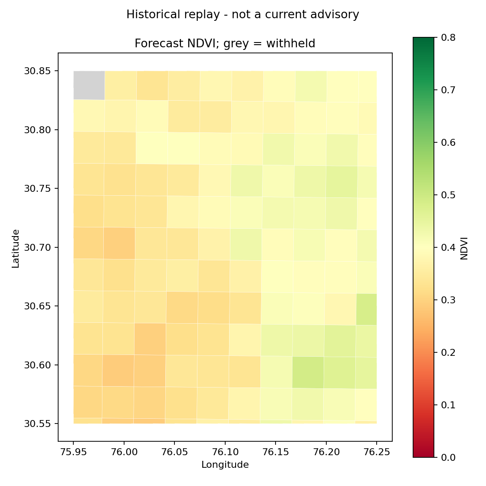
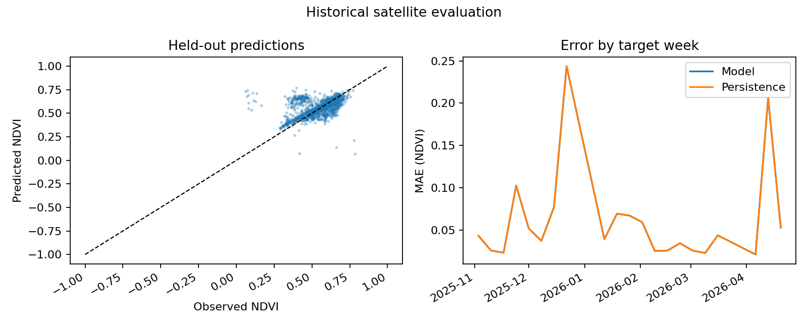

# Punjab Vegetation Watch — technical report

**Applicant:** Harshit Kumar  
**Role:** EO-AI Labs Role 01  
**Configuration used:** R1/S1/D1/T2 (Punjab, Sentinel-2, vegetation NDVI, next-week forecast). The applicant confirms these match the assigned configuration.  
**Saved run:** 20261114T063542Z-4aae3738. Observations end 26 April 2026; the forecast targets the week of 27 April 2026. This is a historical replay.

## User and decision

A district agriculture officer in the Ludhiana–Patiala belt plans weekly inspections. The asset ranks up to ten roughly 3 km analysis cells by lowest predicted next-week NDVI to suggest locations for field investigation. The cells are not administrative blocks or farms. Useful forecasting would beat current-week persistence with adequate coverage; that improvement has not been demonstrated. The self-contained dashboard.html displays the map, shortlist, cell histories, evaluation, and limitations. It opens locally without a server.

## Data and infrastructure

The pipeline searches Earth Search v1 for Sentinel-2 L2A scenes over [75.95, 30.55, 76.25, 30.85] from November 2024 to April 2026. It aligns red, near-infrared, and SCL bands to a 20 m UTM grid, applies recorded scale and offset, retains SCL classes 4 and 5, and computes NDVI. A scene-cell needs at least 30% usable area. Weekly values are medians of daily cell means. Missing targets stay missing; past-only one-week carry is flagged when used as an input.

A SQLite catalogue stores scene metadata, features, failures, and raster checksums. The full ingestion saved **637 scenes and 76,440 scene-cell records with zero unresolved failures**. The latest analysis reused them from cache. Cached analysis cannot establish current provider completeness. Raw source bands and the 1.04 GB derived raster cache are outside this email folder.

## Method and evaluation

Eleven causal inputs summarize recent NDVI, seasonality, and observation support. Earlier-season rolling validation compares persistence, direct histogram gradient boosting, and residual boosting. The earlier season provides **942 training rows across 20 target weeks**. Persistence won validation (mean weekly MAE **0.072884**, versus **0.143942** direct and **0.148284** residual). The separate final fit uses completed historical labels for the April replay; it does not change evaluation scores.

The later-season evaluation scores observed next-week satellite NDVI from November 2025 to April 2026. Because earlier later-season outcomes informed revisions, this is a **development replay**.

| Measure | Selected persistence |
|---|---:|
| Scored cell-weeks | 1,161 of 3,000 (38.7%) |
| MAE / RMSE, NDVI units | 0.072351 / 0.115787 |
| Lowest-ten overlap | 0.475 over eight eligible weeks |

Skill versus persistence and its bootstrap interval are zero because the selected predictor is persistence. This does not mean zero forecast error. The 52-week seasonal baseline has MAE 0.075474 on its 1,036-row common subset, versus persistence 0.070604. The original direct-booster run scored 698 rows and lost to persistence on MAE: 0.067023 versus 0.065114 on that same smaller sample. Do not compare its numeric MAE directly with the expanded sample.

In a separate 12-candidate study, a 25% median-history blend narrowly won earlier validation but lost on the later development season: MAE **0.077117** versus persistence **0.072351**; ranking overlap **0.450** versus **0.475**. Fold winners were unstable. The stable policy remains the default. See [extended research](reports/EXTENDED_RESEARCH.md).

## Sensor fit and fitness for use

Sentinel-2 red and near-infrared measurements directly support NDVI. SCL masking and area thresholds reduce obvious cloud contamination. Low NDVI is not a crop-stress diagnosis: bare soil, harvest, crop timing, haze, and changing valid-pixel support can affect a cell. There is no crop mask, official block boundary, or field stress label. The map shows absolute NDVI, not a Z-score or stress probability.

**Radiometry is provisional.** Item-level offset flags conflict with asset-level offsets for **590 of 637 scenes**. A two-scene diagnostic showed sensitivity to offset choice; an independent original-product comparison failed due to source-host DNS errors. The conflict does not prove the current conversion wrong. See [radiometry review](reports/RADIOMETRY_FOLLOWUP.md).

An officer could use this historical asset for exploratory inspection planning, but it is not validated for operational advice. Production needs verified radiometry, crop and administrative boundaries, field checks, longer independent history, a fresh untouched evaluation, publication-latency testing, and monitored refresh. The shortlist still chooses up to ten eligible cells when all crops might be healthy.

## Reproduction and disclosure

Open dashboard.html to inspect the saved result. From this folder, run py -3.10 -m unittest discover -s tests -v for offline tests, py -3.10 run.py --offline for a labelled synthetic demonstration, or py -3.10 run.py for fresh public-satellite ingestion. See ai_assistant_log.md. Before submitting, supply a real repository URL and verify the application-derived or lab-assigned codes.
